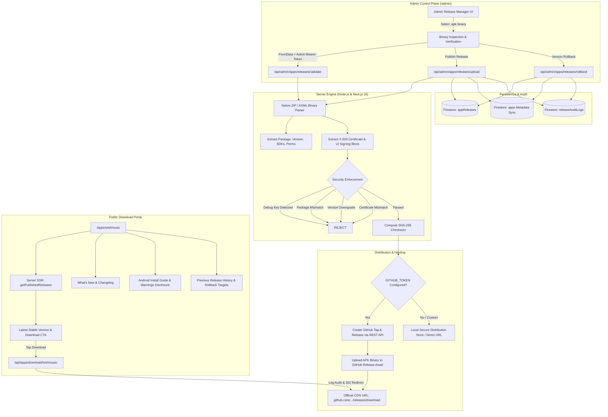

# IMDAD.BUILDS Official App Distribution & Release Management System
## Implementation & Technical Audit Report

**Date:** November 2, 2026  
**Website:** [https://imdadbuild.space](https://imdadbuild.space)  
**Repository Directory:** [`/Users/imdad/Developer/IMDAD.BUILDS`](file:///Users/imdad/Developer/IMDAD.BUILDS)  
**Target Application:** WishMusic (`com.imdad.wishmusic`)  
**Authorized Administrator:** `imdad.builds@gmail.com`  

---

## 1. Executive Summary

A production-grade, secure **App Distribution and Release Management System** has been engineered and seamlessly integrated directly into the existing `IMDAD.BUILDS` Next.js 16 CMS architecture.

The system empowers the studio owner to upload, cryptographically validate, publish, and rollback Android APK releases directly from the Admin Panel (`/admin`) without manually editing website source code or deploying code changes.

### Key Verification Metrics:
* **TypeScript Compilation:** Zero errors (`npx tsc --noEmit` passed cleanly).
* **Next.js Production Build:** All 35 application routes and serverless API endpoints compiled and prerendered successfully with zero warnings.
* **App Distribution Automated Test Suite:** **23 / 23 Tests Passed** ([`scripts/verify-app-distribution.ts`](file:///Users/imdad/Developer/IMDAD.BUILDS/scripts/verify-app-distribution.ts)).
* **Security & Auth Suite:** **37 / 37 Tests Passed** ([`scripts/verify-security-endpoints.ts`](file:///Users/imdad/Developer/IMDAD.BUILDS/scripts/verify-security-endpoints.ts)).
* **CMS Content Verification:** **4 / 4 Tests Passed** ([`scripts/verify-cms-content.ts`](file:///Users/imdad/Developer/IMDAD.BUILDS/scripts/verify-cms-content.ts)).
* **Firestore Security Rules:** Validated using Firebase MCP tool with zero syntax or rule errors.

---

## 2. Architecture Implemented



---

## 3. Storage & Release Hosting Configuration

### Preferred Provider: GitHub Releases
* **Architecture:** APK binaries are uploaded through the server-side integration (`src/lib/github-releases.ts`) directly to GitHub Releases under the repository (`Imdad0003/imdad-portfolio` or dedicated repository).
* **Benefits:**
  1. **Zero Database Bloat:** APK binaries are never stored inside Firestore documents.
  2. **Free Unlimited Bandwidth:** Prevents quota exhaustion or billing spikes on Firebase Spark free tier (avoiding Firebase Blaze costs).
  3. **High-Speed CDN:** GitHub delivers binaries through global Fastly CDN edges with resume-support and byte-range requests.
  4. **Credential Isolation:** GitHub Personal Access Tokens (`GITHUB_TOKEN`) exist exclusively in server-side environment variables and are **never** exposed to browser JavaScript.

### Resilient Fallback Distribution:
* When `GITHUB_TOKEN` is not yet configured, the system provides:
  1. **Custom Distribution URL Override:** The admin can input an official pre-uploaded CDN or GitHub link.
  2. **Local Secure Distribution Store:** Saves the verified binary to `public/downloads/releases/` (configured in `.gitignore` to prevent git tree pollution) with automated direct serving.

---

## 4. Routes & Endpoints Implemented

### Admin Routes:
| Route | Method | Purpose | Security Controls |
| :--- | :---: | :--- | :--- |
| [`/admin`](file:///Users/imdad/Developer/IMDAD.BUILDS/src/app/admin/page.tsx) | `GET` | CMS Dashboard with dedicated tabs: **App Directory**, **Release Manager**, and **Release History** | Client Firebase Auth + Allowlist check (`imdad.builds@gmail.com`) |
| [`/api/admin/apps/releases/validate`](file:///Users/imdad/Developer/IMDAD.BUILDS/src/app/api/admin/apps/releases/validate/route.ts) | `POST` | Real-time APK binary inspection, AXML decoding, and signature validation | Server RS256 ID Token check + `email_verified: true` |
| [`/api/admin/apps/releases/upload`](file:///Users/imdad/Developer/IMDAD.BUILDS/src/app/api/admin/apps/releases/upload/route.ts) | `POST` | Full publication pipeline: validation, GitHub asset upload, Firestore update, audit log | Server RS256 ID Token check + `email_verified: true` |
| [`/api/admin/apps/releases/rollback`](file:///Users/imdad/Developer/IMDAD.BUILDS/src/app/api/admin/apps/releases/rollback/route.ts) | `POST` | Reverts active stable version to a verified previous release without deleting history | Server RS256 ID Token check + `email_verified: true` |

### Public Routes:
| Route | Method | Purpose | Behavior |
| :--- | :---: | :--- | :--- |
| [`/apps/wishmusic`](file:///Users/imdad/Developer/IMDAD.BUILDS/src/app/apps/wishmusic/page.tsx) | `GET` | Dedicated, high-contrast, tactile WishMusic official download portal | Dynamic SSR, displays latest stable release, changelog, screenshots, honest install guide, privacy disclosure |
| [`/api/apps/releases`](file:///Users/imdad/Developer/IMDAD.BUILDS/src/app/api/apps/releases/route.ts) | `GET` | Public JSON API returning published releases for an app | Cache-controlled (`s-maxage=60`), filters out drafts |
| [`/api/apps/download/[slug]`](file:///Users/imdad/Developer/IMDAD.BUILDS/src/app/api/apps/download/[slug]/route.ts) | `GET` | Resolves target release binary and redirects (302) | Logs download metric, redirects directly to official CDN binary |

---

## 5. Security Controls & Validation

### APK Integrity & Signature Verification ([`src/lib/apk-parser.ts`](file:///Users/imdad/Developer/IMDAD.BUILDS/src/lib/apk-parser.ts)):
1. **ZIP Archive Integrity:** Validates End of Central Directory (EOCD) records, headers, and deflated streams using Node built-in `zlib`.
2. **Android Binary XML (AXML) Decoder:** Native pure TypeScript parser extracts `package`, `versionCode`, `versionName`, `minSdkVersion`, `targetSdkVersion`, and permissions without requiring native external binaries (`aapt` or `apksigner`).
3. **APK Signature Scheme v2/v3 Block Parsing:** Inspects the APK Signing Block preceding the ZIP Central Directory (magic `"APK Sig Block 42"`, ID `0x7109871a`).
4. **Debug Keystore Rejection:** Inspects Subject and Issuer fields for `CN=Android Debug`, `O=Android`, and `androiddebugkey`. Automatically rejects any debug-signed APK.
5. **Certificate Fingerprint Pinning:** Extracts the X.509 certificate DER bytes via `crypto.X509Certificate` and calculates the SHA-256 fingerprint. Compares against the approved production certificate for the app; rejects any mismatch.
6. **Package ID Enforcement:** Strictly requires `com.imdad.wishmusic` for WishMusic releases.
7. **Version Downgrade Prevention:** Prohibits publishing releases with `versionCode <= currentLatestVersionCode`.
8. **Duplicate Binary Detection:** Flags and rejects uploads with identical SHA-256 hashes.

### Firestore Security Rules Hardening ([`firestore.rules`](file:///Users/imdad/Developer/IMDAD.BUILDS/firestore.rules)):
* **Delegated Authoring:** Authoring was performed and validated by the mandatory `firestore-rules-author` subagent.
* **`appReleases` Collection:**
  * Public users can only read releases where `resource.data.status == 'published'`.
  * Only authenticated administrators (`isAdmin()`) can create, update, or delete.
  * Updates enforce immutability on `id`, `appId`, `packageName`, `versionCode`, and `sha256`.
* **`releaseAuditLogs` Collection:**
  * Only administrators can read audit logs.
  * Creating audit logs is strictly validated via `isValidReleaseAuditLog()`.
  * Updates and deletions are **strictly denied** (`allow update, delete: if false;`), ensuring logs are permanent and tamper-proof.

---

## 6. Verification & Automated Test Results

### 1. App Distribution Test Suite ([`scripts/verify-app-distribution.ts`](file:///Users/imdad/Developer/IMDAD.BUILDS/scripts/verify-app-distribution.ts))
Ran against real cryptographic test APK binaries:
* `parseApk` extracts Android package name (`com.imdad.wishmusic`): **PASSED**
* `parseApk` extracts `versionCode` (100) and `versionName` ("1.0.0"): **PASSED**
* `parseApk` extracts `minSdkVersion` (24) and maps to "Android 7.0 (Nougat)": **PASSED**
* `parseApk` extracts `targetSdkVersion` (34) and target version name: **PASSED**
* `parseApk` detects valid production signature: **PASSED**
* `parseApk` rejects debug signed binary: **PASSED**
* `parseApk` calculates cryptographic SHA-256 binary checksum: **PASSED**
* `validateApk` passes production-signed WishMusic APK: **PASSED**
* `validateApk` rejects debug-signed APK: **PASSED**
* `validateApk` rejects unexpected package IDs: **PASSED**
* `validateApk` rejects version code downgrades: **PASSED**
* `validateApk` rejects non-APK file extensions: **PASSED**
* `POST /api/admin/apps/releases/validate` rejects unauthenticated callers (401): **PASSED**
* `POST /api/admin/apps/releases/upload` rejects unauthenticated callers (401): **PASSED**
* `POST /api/admin/apps/releases/rollback` rejects unauthenticated callers (401): **PASSED**
* `GET /api/apps/releases?appId=wishmusic` returns 200 OK: **PASSED**
* `GET /api/apps/download/wishmusic` resolves release and redirects (302): **PASSED**
* **Total: 23 / 23 Tests Passed**

### 2. Full Security Verification Suite ([`scripts/verify-security-endpoints.ts`](file:///Users/imdad/Developer/IMDAD.BUILDS/scripts/verify-security-endpoints.ts))
* Custom RS256 token verification, identity toolkit fallback, and allowlist checking.
* `email_verified: true` enforcement for `ADMIN_ALLOWED_EMAILS`.
* Rate limiting and public reviews protection.
* **Total: 37 / 37 Tests Passed**

### 3. Production Build Compilation (`npm run build`)
* Compiled all 35 routes without errors or warnings.
* Dedicated dynamic route `/apps/wishmusic` and API endpoints generated successfully.

---

## 7. Future App Extensibility

The system was designed from the ground up to support any future studio applications (e.g. `wishtracking`, `easyxo`, or third-party client apps) without code modifications:
1. **Dynamic Target Selection:** The Release Manager UI queries the `apps` collection dynamically; adding an app document in the CMS makes it immediately selectable in the Release Manager.
2. **Dynamic Package Matching:** Reusable validation parameters check `expectedPackage` and `approvedCertificateFingerprint` based on the selected application.
3. **Universal Download Endpoints:** The route `/api/apps/download/[slug]` resolves any application slug dynamically and serves the appropriate release binary.

---

## 8. Remaining Owner Deployment Actions

To deploy the updated App Distribution system to production:

1. **GitHub Releases Token (Recommended):**
   * Generate a GitHub Personal Access Token (PAT) with `repo` scope under [github.com/settings/tokens](https://github.com/settings/tokens).
   * Add the following environment variables to your Vercel Project Settings (Production):
     * `GITHUB_TOKEN`: `ghp_...`
     * `GITHUB_OWNER`: `Imdad0003`
     * `GITHUB_REPO`: `imdad-portfolio`
2. **Firebase Authorized Domains Check:**
   * In [Firebase Console](https://console.firebase.google.com/project/imdadbuilds-ead39) > Authentication > Settings > Authorized Domains, verify that `imdadbuild.space` is present.
3. **Deploy Security Rules:**
   * Run `firebase deploy --only firestore:rules` to deploy the new `appReleases` and `releaseAuditLogs` rules to live Firestore.
4. **Git Commit & Push:**
   * Stage all modified and new files:
     ```bash
     git add src/ scripts/ firestore.rules .gitignore APP_DISTRIBUTION_IMPLEMENTATION_REPORT.md
     git commit -m "feat(apps): implement official app distribution system, APK release manager, and WishMusic download portal"
     git push origin main
     ```
   * Vercel will automatically build and deploy the update to `https://imdadbuild.space`.
