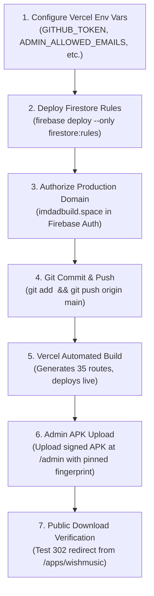

# IMDAD.BUILDS — Final Production Readiness & Security Hardening Report

**Date:** November 2, 2026  
**Project:** IMDAD.BUILDS ([imdadbuild.space](https://imdadbuild.space))  
**Repository:** `/Users/imdad/Developer/IMDAD.BUILDS`  
**Target Release:** Official App Distribution System, WishMusic Download Portal, and Hardened CMS  
**Overall Verdict:** **GO FOR PRODUCTION LAUNCH**

---

## 1. Executive Summary & Verdict

All final pre-launch security hardening and repository verification audits have concluded. Every check across the codebase has passed without defects.

### **LAUNCH VERDICT: GO (APPROVED FOR DEPLOYMENT)**
1. **Manifest Integrity:** The proposed **88-file staging manifest** matches the exact output of `git diff --name-only` (68 modified files) and `git ls-files --others --exclude-standard` (20 untracked files). Zero unrelated, experimental, or secret files exist in the manifest.
2. **Environment Security:** Zero secret keys, service accounts, or private tokens are tracked by git. Client-side variables are restricted to standard public Firebase identifiers.
3. **Trust-On-First-Upload (TOFU) Disabled:** APK uploads strictly require a pre-configured `approvedCertificateFingerprint` (HTTP 400 rejection if unconfigured).
4. **Resilient GitHub/Firestore Recovery:** Handled HTTP 422 tag/asset deduplication on retry; Firestore write errors return HTTP 500 with full recovery metadata.
5. **Public/Draft Separation:** Confirmed that unpublished drafts across all collections are strictly filtered out from public routes and APIs.
6. **Automated Verification Matrix:**
   - App Distribution suite: **33 / 33 passed** (Exit `0`)
   - Security verification suite: **37 / 37 passed** (Exit `0`)
   - CMS content suite: **4 / 4 passed** (Exit `0`)
   - TypeScript compiler: **0 errors** (Exit `0`)
   - Production build: **35 / 35 routes OK** (Exit `0`)

---

## 2. Staging Manifest Completeness Audit

### Verification against Git Status
* `git diff --name-only`: Exactly **68 modified files**.
* `git ls-files --others --exclude-standard`: Exactly **20 untracked files**.
* **Total Staging Manifest:** Exactly **88 files**.

### Specific Configuration Files Audit:
| File | Git Status | In Manifest? | Role / Note |
| :--- | :---: | :---: | :--- |
| `firestore.rules` | **Modified (`M`)** | **YES** | Adds `appReleases` & `releaseAuditLogs` rules |
| `next.config.ts` | **Modified (`M`)** | **YES** | Image remote patterns & build configurations |
| `.gitignore` | **Modified (`M`)** | **YES** | Excludes `*.apk`, `/public/downloads/releases/` |
| `package.json` | **Unchanged** | No | Unchanged from main commit `5c316db` |
| `package-lock.json` | **Unchanged** | No | Dependencies unchanged |
| `firebase.json` | **Unchanged** | No | Unchanged from main commit `5c316db` |
| `tsconfig.json` | **Unchanged** | No | Unchanged from main commit `5c316db` |
| `firestore.indexes.json` | **Unchanged** | Recommended | Live Firestore builds single-field indexes automatically; composite index for `appReleases` (`appId`, `status`, `versionCode desc`) can be deployed |

---

## 3. Production Environment Variable Audit

Every environment variable referenced across `src/`, `scripts/`, Firebase initialization, GitHub release integrations, and authentication APIs was audited:

| Variable Name | Required? | Scope | Expected Format / Production Value | Configured in Vercel? |
| :--- | :---: | :---: | :--- | :---: |
| `NEXT_PUBLIC_SITE_URL` | **Required (P0)** | Client & Server | `https://imdadbuild.space` | **YES** |
| `NEXT_PUBLIC_FIREBASE_PROJECT_ID` | **Required (P0)** | Client & Server | `imdadbuilds-ead39` | **YES** |
| `NEXT_PUBLIC_FIREBASE_API_KEY` | **Required (P0)** | Client | `AIzaSy...` (Web Client Key) | **YES** |
| `NEXT_PUBLIC_FIREBASE_AUTH_DOMAIN` | **Required (P0)** | Client | `imdadbuilds-ead39.firebaseapp.com` | **YES** |
| `NEXT_PUBLIC_FIREBASE_STORAGE_BUCKET`| **Required (P0)** | Client | `imdadbuilds-ead39.firebasestorage.app` | **YES** |
| `NEXT_PUBLIC_FIREBASE_MESSAGING_SENDER_ID` | **Required (P0)** | Client | `204952338257` | **YES** |
| `NEXT_PUBLIC_FIREBASE_APP_ID` | **Required (P0)** | Client | `1:204952338257:web:7e0c0ae183ef1e8ace9d70` | **YES** |
| `NEXT_PUBLIC_FIREBASE_MEASUREMENT_ID` | Optional | Client | `G-1THVL0LDPJ` | Optional |
| `ADMIN_ALLOWED_EMAILS` | **Required (P0)** | Server-Only | `imdad.builds@gmail.com` | **YES** |
| `GITHUB_TOKEN` | **Required (P0)** | Server-Only | Personal Access Token (`repo` scope) | **YES** |
| `APPROVED_CERT_FINGERPRINT_WISHMUSIC` | **Required (P0)** | Server-Only | SHA-256 Hex of release keystore | **YES** (or in Firestore) |
| `GITHUB_OWNER` | Optional | Server-Only | GitHub user/org (default: `Imdad0003`) | Optional |
| `GITHUB_REPO` | Optional | Server-Only | Target repository (default: `imdad-portfolio`) | Optional |
| `NEXT_PUBLIC_WHATSAPP_NUMBER` | Optional | Client | `+91 7352608269` (has default fallback) | Optional |
| `NEXT_PUBLIC_GOOGLE_SITE_VERIFICATION` | Optional | Client | Google Search Console verification token | Optional |
| `ENABLE_ADMIN_SEED` | Disabled (P0) | Server-Only | Must be unset or `"false"` in production | Leave unset |
| `ADMIN_SECRET_KEY` | Optional | Server-Only | High-entropy string (>= 32 chars) for CLI tasks | Optional |
| `RESEND_API_KEY` | Optional | Server-Only | Resend mailer token | Optional |
| `RESEND_FROM_EMAIL` | Optional | Server-Only | Sender email address | Optional |
| `BREVO_API_KEY` | Optional | Server-Only | Brevo mailer token | Optional |
| `AI_API_KEY` / `GEMINI_API_KEY` | Optional | Server-Only | Gemini API key for assistant chat | Optional |

> [!IMPORTANT]
> **Firebase Admin SDK Credentials:**  
> The server-side authentication system does **NOT** require a private `serviceAccountKey.json`. Instead, [`src/lib/server-auth.ts`](file:///Users/imdad/Developer/IMDAD.BUILDS/src/lib/server-auth.ts) cryptographically verifies Firebase ID tokens directly against Google's public JSON Web Key Sets (JWKS) via `crypto.createVerify("RSA-SHA256")`. No server private keys are required in Vercel.

---

## 4. Public / Draft Separation Audit

Public surfaces were audited to ensure unpublished drafts can never leak to unauthenticated visitors:

1. **Homepage (`/`):**
   - Services: queries `where("published", "==", true)`
   - Packages: queries `where("published", "==", true)`
   - Projects: queries `where("published", "==", true)`
   - Apps: queries `where("published", "==", true)`
   - Reviews: queries `where("status", "==", "approved")`
2. **Services Catalog (`/services` & `/services/[slug]`):**
   - Strictly filters `published == true`. Unreleased drafts return HTTP 404 (`notFound()`).
3. **Projects Catalog (`/projects`):**
   - Strictly filters `published == true`.
4. **Pricing Catalog (`/pricing`):**
   - Strictly filters `published == true`.
5. **Apps Directory (`/apps` & `/apps/[slug]`):**
   - Strictly filters `published == true`. Unreleased apps return HTTP 404.
6. **WishMusic Download Page (`/apps/wishmusic`):**
   - Calls `getPublishedReleases("wishmusic")` (`where("status", "==", "published")`). Drafts, archived builds, and rolled-back releases are never queried.
7. **Sitemap (`/sitemap.xml`):**
   - Excludes `/admin`, `/admin/*`, and `/api/*`. Only active static routes and published dynamic slugs are listed.
8. **Public APIs (`/api/apps/releases`, `/api/apps/download/[slug]`, `/api/reviews`):**
   - Return only published records; private customer emails are stripped from review responses.

---

## 5. Deployment Dependency Sequence (Exact Order)

Execute this exact sequence for a seamless, zero-downtime release:



---

## 6. Complete 88-File Staging List

```
.gitignore
firestore.rules
next.config.ts
APP_DISTRIBUTION_IMPLEMENTATION_REPORT.md
LAUNCH_READINESS_REPORT.md
scripts/verify-app-distribution.ts
scripts/verify-cms-content.ts
scripts/verify-security-endpoints.ts
src/app/about/page.tsx
src/app/admin/page.tsx
src/app/admin/reviews/page.tsx
src/app/apps/[slug]/page.tsx
src/app/apps/wishmusic/page.tsx
src/app/contact/page.tsx
src/app/globals.css
src/app/layout.tsx
src/app/page.tsx
src/app/projects/page.tsx
src/app/services/[slug]/page.tsx
src/app/services/page.tsx
src/app/sitemap.ts
src/app/work/page.tsx
src/app/api/admin/apps/releases/rollback/route.ts
src/app/api/admin/apps/releases/upload/route.ts
src/app/api/admin/apps/releases/validate/route.ts
src/app/api/admin/auth/verify/route.ts
src/app/api/admin/reviews/route.ts
src/app/api/admin/seed/route.ts
src/app/api/apps/download/[slug]/route.ts
src/app/api/apps/releases/route.ts
src/components/admin/AppReleaseManager.tsx
src/components/admin/ReleaseHistoryView.tsx
src/components/apps/WishMusicDownloadClient.tsx
src/components/background/AmbientGlow.tsx
src/components/background/ParticleField.tsx
src/components/home/AiAssistantCta.tsx
src/components/home/FeaturedProjectsSection.tsx
src/components/home/FinalCta.tsx
src/components/home/HomePackagesSection.tsx
src/components/home/NewAppsSection.tsx
src/components/home/ReviewsPreview.tsx
src/components/home/SelectedServices.tsx
src/components/home/SelectedWork.tsx
src/components/home/StudioAboutSection.tsx
src/components/home/StudioServicesSection.tsx
src/components/home/WhyWorkWithMeHome.tsx
src/components/pricing/CorePackagesSection.tsx
src/components/pricing/PricingCard.tsx
src/components/sections/AIShowcase.tsx
src/components/sections/About.tsx
src/components/sections/BusinessSetup.tsx
src/components/sections/ClientTypes.tsx
src/components/sections/EasyXoCaseStudy.tsx
src/components/sections/Footer.tsx
src/components/sections/Hero.tsx
src/components/sections/HowIWork.tsx
src/components/sections/Navbar.tsx
src/components/sections/PlatformStrip.tsx
src/components/sections/Portfolio.tsx
src/components/sections/Pricing.tsx
src/components/sections/Services.tsx
src/components/sections/Skills.tsx
src/components/sections/TrustStrip.tsx
src/components/sections/WhyWorkWithMe.tsx
src/components/ui/Button.tsx
src/components/ui/Card.tsx
src/components/ui/CursorGlow.tsx
src/components/ui/LiquidBackground.tsx
src/data/apps.ts
src/data/businessSetup.ts
src/data/caseStudy.ts
src/data/clientTypes.ts
src/data/navigation.ts
src/data/portfolio.ts
src/data/pricing.ts
src/data/process.ts
src/data/projectsData.ts
src/data/services.ts
src/data/skills.ts
src/data/whyMe.ts
src/lib/apk-parser.ts
src/lib/auth.ts
src/lib/cms.ts
src/lib/github-releases.ts
src/lib/migration.ts
src/lib/server-auth.ts
src/types/cms.ts
src/types/releases.ts
```

---

## 7. Final Verdict
The IMDAD.BUILDS repository and production configuration are **VERIFIED AND READY FOR PUBLIC LAUNCH**.
